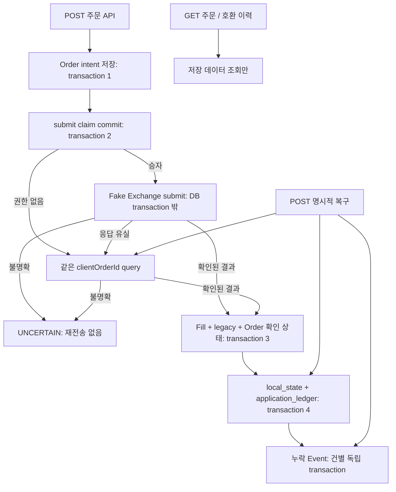

# Architecture

확인되지 않은 주문 결과와 이미 저장된 체결·적용 상태를 구분합니다. [OrderService](../src/main/java/com/codewus/showcase/order/OrderService.java)가 각 경계를 조합하며, [PostgresReliabilityTest](../src/postgresTest/java/com/codewus/showcase/PostgresReliabilityTest.java)가 실제 DB에서 경계 사이 실패를 확인합니다.

## 저장 구조

| 단계 | 테이블과 역할 | migration / SQL |
| --- | --- | --- |
| V1 | `legacy_trade`: 최소 과거 거래 기록 | [V1](../src/main/resources/db/migration/V1__legacy_trade.sql), [LegacyTradeMapper](../src/main/resources/mapper/LegacyTradeMapper.xml) |
| V2 | `demo_order`: 요청과 확인 상태 / `fill`: 확인된 aggregate / `event`: 후속 이력 | [V2](../src/main/resources/db/migration/V2__order_fill_event.sql), [FillMapper](../src/main/resources/mapper/FillMapper.xml), [EventMapper](../src/main/resources/mapper/EventMapper.xml) |
| V3 | `submit_claim`: 제출 권한 / `application_ledger`: 적용 marker / `local_state`: 합성 상태 | [V3](../src/main/resources/db/migration/V3__claim_and_local_application.sql), [ApplicationMapper](../src/main/resources/mapper/ApplicationMapper.xml) |

`FillRecorder.record`는 신규 결과를 legacy와 Fill에 함께 기록합니다. 이는 이번에 확인한 결과의 호환 기록이며 기존 모든 거래를 backfill하지 않습니다. `OrderHistoryService.history`는 신규 구조를 우선합니다. pending Order는 체결 이력에 넣지 않고 주문 단건 조회에서 확인합니다. [호환 조회 테스트](../src/test/java/com/codewus/showcase/OrderHistoryTest.java)가 우선순위와 정렬·limit을 설명합니다.

## 복구와 읽기의 경계

[RecoveryService.recover](../src/main/java/com/codewus/showcase/order/RecoveryService.java)는 Fill이 없으면 결과 query, Fill이 있으면 ledger 확인, Event가 없으면 해당 type 저장으로 이어갑니다. submit claim을 새로 얻거나 주문을 다시 제출하지 않습니다. [FillApplicationService.apply](../src/main/java/com/codewus/showcase/order/FillApplicationService.java)는 actor/symbol의 상태 row를 잠근 뒤 marker를 확인하고 상태와 marker를 함께 commit합니다.

[DemoOrderController](../src/main/java/com/codewus/showcase/api/DemoOrderController.java)의 GET은 `get`과 `history`에만 연결됩니다. `realHttpGetsDoNotApplyRepairOrChangeAnyTable`은 미적용 Fill과 누락 Event가 있어도 GET 전후 일곱 테이블의 전체 snapshot이 같은지 확인합니다.
